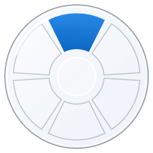
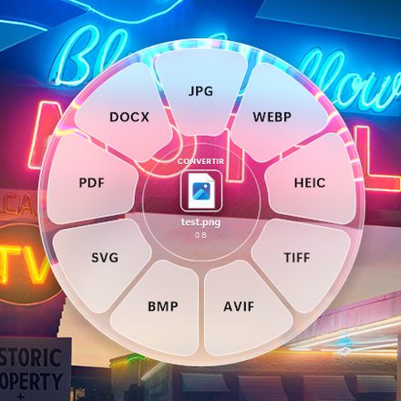
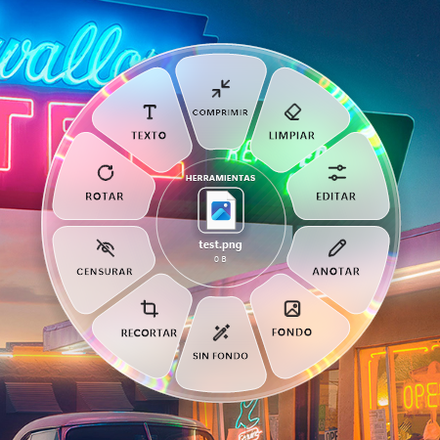
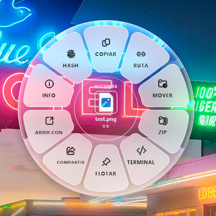

<p align="center">
  
</p>

<h1 align="center">FileTools</h1>

<p align="center">
  <a href="https://github.com/FranciscoFdez05/FileTools/releases/latest"></a>
  
  
  <a href="LICENSE"></a>
</p>

Convierte, edita y gestiona archivos arrastrándolos a una rueda de cristal. Aplicación nativa de Windows en C++20,
todo en local y en un único `.exe`.

<p align="center">
  
  
  
</p>

## ✨ Características ✨


| Tipo | Convertir | Herramientas |
|---|---|---|
| **Imágenes** (JPG, PNG, WEBP, HEIC, TIFF, AVIF, BMP, GIF, ICO, SVG) | JPG, PNG, WEBP, HEIC, TIFF, AVIF, BMP, SVG (vectorizar), PDF, DOCX | Comprimir, limpiar metadatos, editar, anotar, fondo, quitar fondo, recortar, escalar, censurar datos sensibles (OCR), rotar, extraer texto (OCR) |
| **PDF** | DOCX, JPG, PNG, TXT, MD (todas las páginas, 300 ppp) | Comprimir, dividir, unir (PDF + imágenes), rotar, censurar, extraer texto, limpiar metadatos |
| **Documentos** (TXT, MD, HTML, DOCX y cualquier archivo de texto) | DOCX, TXT, MD, HTML, PDF | Unir, contar palabras, hash, limpiar metadatos |
| **Audio** | MP3, M4A, WAV, FLAC, OGG, OPUS, AIFF, WMA | Comprimir, normalizar, mono, quitar silencios, limpiar metadatos |
| **Vídeo** | MP4, MOV, MKV, WEBM, AVI, WMV, GIF, MP3 | Comprimir, silenciar, extraer audio, GIF, rotar, fotograma, limpiar metadatos |
| **Archivos** (ZIP, TAR, TAR.GZ, 7Z, RAR) y carpetas | ZIP, TAR, TAR.GZ | Extraer, hash, tamaño de carpeta |
| **Cualquier otro archivo** | — | Hash, limpiar metadatos |

**Enviar** (herramientas de cualquier archivo o carpeta): pasa archivos a un móvil u otro dispositivo con un
enlace, un código QR, Bluetooth o Uso compartido cercano (ver abajo).

**Acciones** (cualquier archivo o carpeta): copiar, copiar ruta, mover, ZIP, abrir terminal, flotar (tarjeta para
dejar archivos y arrastrarlos más tarde), compartir, abrir con, **info** (metadatos) y **hash**.

### Hash y metadatos

**Hash** e **Info** abren una ventana con los resultados en vez de copiarlos sin más:

- **Hash:** MD5, SHA-1, SHA-256 y SHA-512 de cada archivo (en una carpeta, de todos los archivos que contiene).
  Pega un hash en la caja de arriba para comprobar si coincide.
- **Info:** datos del archivo (tamaño, fechas, atributos y de dónde se descargó), las propiedades de Windows y,
  si está instalado [ExifTool](https://exiftool.org), todas sus etiquetas (EXIF, GPS, XMP, IPTC, QuickTime,
  ID3, PDF…). Se puede buscar y el botón **Quitar metadatos** crea una copia limpia.
  Si ExifTool no está en el PATH, el botón **Conectar ExifTool…** permite elegir `exiftool.exe`; la ruta se
  guarda y se usa a partir de entonces.

En ambas: doble clic en una fila copia su valor, **Copiar** copia las filas seleccionadas y **Copiar todo** la tabla.

**Limpiar** (rueda de herramientas) guarda `nombre sin metadatos.ext`; el original no se toca:

| Tipo | Cómo |
|---|---|
| JPG y PNG | Sin recomprimir; conserva el perfil de color y la orientación |
| Otras imágenes | Con ExifTool si está instalado; si no, se recodifican |
| Audio y vídeo | ffmpeg copia las pistas sin recodificar y descarta etiquetas, capítulos y GPS |
| DOCX, XLSX, PPTX, ODT… | Se vacían las propiedades del documento (autor, empresa, fechas, plantilla…) |
| PDF | Se reconstruyen las páginas (ver limitaciones) |
| Resto | ExifTool, para los formatos que sabe escribir |

La copia tampoco conserva el origen de descarga que Windows guarda junto a los archivos bajados de Internet.

### Enviar a otro dispositivo

**Enviar** abre una ventana que comparte los archivos mientras está abierta:

- **Enlace y QR (Wi-Fi o cable):** FileTools levanta un pequeño servidor web en el PC y muestra su dirección
  (`http://192.168.1.34:8765/k3j9xq2a/`) y un código QR. Escanéalo con la cámara del móvil o abre el enlace en
  cualquier navegador de un dispositivo **conectado a la misma red**: verás una página con cada archivo, su tamaño,
  una vista previa de las imágenes y un botón **Descargar**. El enlace lleva una clave aleatoria, así que nadie más
  de la red puede adivinarlo, y deja de funcionar al pulsar **Detener** o cerrar la ventana. Las carpetas se
  envían como ZIP. Si el PC tiene varias redes (Wi-Fi, cable, VPN…), **Cambiar de red** elige la dirección.
  La ventana indica cuándo se conecta un dispositivo y el progreso de cada descarga.
- **Bluetooth…** abre el asistente de transferencia Bluetooth de Windows con los archivos ya elegidos.
- **Compartir…** abre el panel Compartir de Windows, con **Uso compartido cercano** para enviarlo por Wi-Fi o
  Bluetooth a otro PC con Windows.

La primera vez Windows puede preguntar si permite a FileTools acceder a la red: acepta en **redes privadas**. Si el
otro dispositivo no carga la página, comprueba que ambos están en la misma red y que la red del PC está marcada
como privada.

### Quitar fondo y vectorizar

- **Sin fondo** (herramientas de imagen) abre el editor en la pestaña **Fondo**, que recorta el sujeto principal
  con vista previa en vivo. **Umbral** decide cuánto de lo dudoso se quita (súbelo para quitar más fondo, bájalo para
  conservar más del sujeto) y **Borde suave** va de un corte nítido a un contorno difuminado; los valores se recuerdan.
  Guarda `nombre sin fondo.png` con transparencia, y se puede combinar con los ajustes, anotaciones y el recorte.
  Usa el modelo de segmentación [U²-Net](https://github.com/xuebinqin/U-2-Net) (versión ligera `u2netp`,
  incrustado en el ejecutable) con Windows ML, en local, y refina el borde con la imagen a resolución completa para
  conservar detalles como el pelo. Tarda menos de un segundo. Funciona mejor con un sujeto claro (personas,
  animales, objetos); en escenas muy cargadas puede dejar restos del fondo.
- **SVG** (convertir imagen) vectoriza la imagen: reduce los colores a una paleta (hasta 16), traza el contorno
  de cada zona y lo convierte en líneas y curvas. Ideal para logos, iconos, dibujos y capturas; las fotos quedan
  con aspecto de póster. La transparencia se conserva.

### Editor de imágenes

Las herramientas **Editar**, **Anotar**, **Recortar**, **Escalar** y **Sin fondo** abren un editor integrado:

- **Ajustes:** brillo, contraste, saturación, temperatura, nitidez, rotar y voltear.
- **Anotar:** lápiz, resaltador, flecha, rectángulo, elipse y texto, con colores y grosor.
- **Recortar:** libre o con proporción fija (original, 1:1, 4:3, 16:9, 9:16) y detección automática de bordes.
- **Fondo:** quita el fondo con umbral y suavizado de borde ajustables.
- **Tamaño:** agranda o reduce la imagen a mano arrastrando los tiradores del marco: las esquinas escalan
  manteniendo la proporción y los lados estiran o encogen solo el ancho o el alto. Una línea discontinua marca el
  tamaño original. También hay un deslizador (10 % a 400 %) y porcentajes fijos (25, 50, 75, 150, 200 y 400 %), y
  se muestra el tamaño final en píxeles. Si hay recorte, se escala la zona recortada; el resultado no puede pasar
  de 16384 px de lado. Si solo se escala, la copia se guarda como `nombre escalado.ext`.

Guarda una copia (`nombre editado.ext`) a resolución completa; el original no se modifica.

## 🖥️ Requisitos


- Windows 10 (1809) o Windows 11, x64.

Componentes opcionales:

| Para | Necesitas |
|---|---|
| Audio y vídeo | [ffmpeg](https://ffmpeg.org): `winget install Gyan.FFmpeg`, o `ffmpeg.exe` junto a `FileTools.exe` |
| HEIC | "Extensiones de imagen HEIF" y "Extensiones de vídeo HEVC" de Microsoft Store |
| Quitar fondo | Windows 10 2004 o superior (Windows ML viene con el sistema) |
| OCR (texto, censurar, PDF → texto) | Un idioma de Windows con reconocimiento óptico de caracteres (viene con el idioma de la interfaz) |
| Todos los metadatos y limpiar más formatos | [ExifTool](https://exiftool.org): `winget install OliverBetz.ExifTool`, o `exiftool.exe` junto a `FileTools.exe` |

Las conversiones que no tengan su componente disponible muestran un mensaje explicando qué instalar.

Para compilar: Visual Studio 2022 o 2026 con **Desarrollo para el escritorio con C++** (incluye CMake, el SDK de
Windows y vcpkg).

## 📦Guía de instalación⚙️


Descarga `FileTools-win-x64.zip` desde [Releases](../../releases), descomprímelo y ejecuta `FileTools.exe`.
Las novedades de cada versión están en [CHANGELOG.md](CHANGELOG.md).

### Compilar desde el código

```powershell
.\build.ps1
```

El script localiza Visual Studio y su vcpkg, instala las dependencias de [vcpkg.json](vcpkg.json)
(libwebp, libavif y lunasvg, enlazadas estáticamente) y deja el ejecutable en `build\Release\FileTools.exe`.
Para usar otro vcpkg, define `VCPKG_ROOT`.

A mano:

```powershell
cmake -S . -B build -A x64 -DCMAKE_TOOLCHAIN_FILE="$env:VCPKG_ROOT\scripts\buildsystems\vcpkg.cmake"
cmake --build build --config Release
```

Cada push a `main` se compila en GitHub Actions; al publicar un tag `v*` se crea una release con el ejecutable.

## 📋Guía de uso 🕹️


1. Ejecuta `FileTools.exe`: queda en la bandeja del sistema.
2. Empieza a arrastrar uno o varios archivos y, **sin soltar**, pulsa una tecla:

   | Tecla | Rueda |
   |---|---|
   | **Mayús** | Convertir a otro formato |
   | **Ctrl** | Herramientas |
   | **Alt** | Acciones |

3. Suelta sobre una opción. El resultado aparece en el centro de la rueda: **arrástralo** a donde quieras, haz
   **clic** para verlo en el Explorador o suéltalo sobre otra opción para encadenar operaciones.

Durante el arrastre puedes pulsar otra tecla para cambiar de rueda. Con archivos seleccionados en el Explorador,
**Ctrl+Alt+Espacio** abre la rueda con el teclado (flechas, Intro, Tab, Esc). El atajo se puede cambiar en los
ajustes.

### Ajustes

**Ctrl+Alt+S**, un clic en el icono de la bandeja o volver a abrir `FileTools.exe` (también `FileTools.exe
--settings`) muestran la ventana de ajustes. Los cambios se guardan al momento:

- Dónde guardar los resultados: junto al original, Descargas o Escritorio.
- Calidad al convertir a JPG, WEBP, AVIF y HEIC: 60 a 100 %. Por defecto **100 %**, que guarda WEBP y AVIF
  sin pérdida (píxeles idénticos) y JPG y HEIC a calidad máxima (JPG sin submuestreo de color). La herramienta
  **Comprimir** usa siempre su propia calidad, pensada para reducir tamaño.
- Iniciar con Windows y avisar cuando termina una tarea en segundo plano (los errores se avisan siempre).
- Estado de ffmpeg y ExifTool, con **Elegir…** para indicar dónde está `exiftool.exe`.
- Los atajos de teclado (rueda y ajustes): haz clic en uno y pulsa la nueva combinación, que debe llevar Ctrl o
  Alt (Esc cancela). Si Windows u otra aplicación ya la usa, se mantiene la anterior. **Restablecer** vuelve al
  atajo por defecto (Ctrl+Alt+Espacio y Ctrl+Alt+S).
- **Cerrar tarjetas flotantes** y **Salir de FileTools**.

El clic derecho en el icono de la bandeja abre el menú rápido con las mismas opciones.

### Línea de comandos

Las mismas acciones de la rueda se pueden ejecutar sin interfaz:

```powershell
FileTools.exe --run to:webp foto.jpg
FileTools.exe --run tool:compress --log resultado.txt captura.png
FileTools.exe --run tool:hash --log hashes.txt video.mp4
```

Identificadores: `to:<ext>` y `tool:<compress|metadata|info|hash|nobg|background|redact|rotate|ocr|split|merge|count|mute|audio|gif|frame|normalize|mono|silence|extract>`, `act:zip`.
`tool:info` y `tool:hash` escriben la tabla en el log (grupo, nombre y valor separados por tabuladores);
`--panel tool:info <archivo>` abre la ventana sin la rueda y `--send <archivos…>` abre la ventana de enviar.

### Limitaciones conocidas

- PDF → texto/DOCX usa OCR sobre la página renderizada, no el texto incrustado.
- Comprimir, dividir, unir, rotar, censurar y limpiar metadatos de PDF rasterizan las páginas, así que el texto deja
  de ser seleccionable. (ExifTool sólo oculta los metadatos de un PDF: la versión anterior sigue dentro del archivo.)
- El efecto de cristal se calcula al abrir la rueda; si el fondo cambia mientras está abierta, no se actualiza.

## 🤝 Contribuciones 🤝


Las contribuciones son bienvenidas: abre un issue para proponer cambios o informar de errores, o envía un pull
request. Estructura del código:

| Archivo | Contenido |
|---|---|
| [src/main.cpp](src/main.cpp) | Bandeja, hooks globales de ratón/teclado, atajo, modo CLI |
| [src/wheel.cpp](src/wheel.cpp) | Rueda radial: ventana layered, cristal, destino OLE, arrastrar el resultado |
| [src/editor.cpp](src/editor.cpp) | Editor de imágenes (ajustes, anotaciones, recorte, escala) |
| [src/actions.cpp](src/actions.cpp) | Catálogo de acciones por tipo de archivo y su ejecución |
| [src/image.cpp](src/image.cpp) | Imágenes con WIC + libwebp/libavif |
| [src/pdf.cpp](src/pdf.cpp) | Render de PDF (Windows.Data.Pdf) y escritor de PDF |
| [src/ocr.cpp](src/ocr.cpp) | OCR (Windows.Media.Ocr) y censura de datos sensibles |
| [src/docs.cpp](src/docs.cpp) | DOCX, Markdown, HTML, TXT y PDF de texto |
| [src/zip.cpp](src/zip.cpp) | ZIP (escritura y lectura con inflate propio) |
| [src/media.cpp](src/media.cpp) | ffmpeg y tar.exe |
| [src/bgremove.cpp](src/bgremove.cpp) | Quitar fondo: U²-Net con Windows ML y refinado del borde |
| [src/vectorize.cpp](src/vectorize.cpp) | Vectorizar imágenes a SVG |
| [src/svg.cpp](src/svg.cpp) | Rasterizar SVG con lunasvg (Direct2D como respaldo) |
| [src/svgtext.cpp](src/svgtext.cpp) | Texto de los SVG con DirectWrite cuando se dibujan con Direct2D (que no lo dibuja) |
| [src/fileinfo.cpp](src/fileinfo.cpp) | Hashes, metadatos (Windows y ExifTool) y limpieza de documentos de Office |
| [src/infopanel.cpp](src/infopanel.cpp) | Ventana de hash y metadatos |
| [src/sendpanel.cpp](src/sendpanel.cpp) | Ventana de enviar: QR, enlace, Bluetooth y Compartir |
| [src/fileserver.cpp](src/fileserver.cpp) | Servidor HTTP para descargar los archivos desde la red local |
| [src/qrcode.cpp](src/qrcode.cpp) | Generador de códigos QR |
| [src/settingspanel.cpp](src/settingspanel.cpp) | Ventana de ajustes |
| [src/glass.cpp](src/glass.cpp) | Estilo de cristal compartido por las ventanas |
| [src/shellutil.cpp](src/shellutil.cpp) | Miniaturas, portapapeles, Explorador, compartir |
| [src/floatshelf.cpp](src/floatshelf.cpp) | Tarjetas flotantes |
| [res/](res/) | Icono, manifiesto, recursos de versión, `make-icon.ps1` para regenerar el icono y `icons.ttf`, los iconos de la interfaz (ver abajo) |

### Iconos

Los iconos de la interfaz son [Fluent UI System Icons](https://github.com/microsoft/fluentui-system-icons) de
Microsoft (licencia MIT, [res/ICONS-LICENSE.txt](res/ICONS-LICENSE.txt)). Van incrustados en el ejecutable como
una fuente reducida, `res/icons.ttf` (8 KB), así que no dependen de las fuentes instaladas. Para cambiar o añadir
iconos, edita la tabla de [res/make-icon-font.py](res/make-icon-font.py) y regenera la fuente:

```powershell
pip install fonttools
python res\make-icon-font.py FluentSystemIcons-Regular.ttf FluentSystemIcons-Regular.json
```

El modelo `res/u2netp.onnx` de U²-Net se distribuye bajo licencia Apache 2.0
([res/U2NET-LICENSE.txt](res/U2NET-LICENSE.txt)).

## 📜 Licencia

📄 Este proyecto está licenciado bajo la Licencia MIT. Consulta el archivo [`LICENSE`](LICENSE) para más detalles.


**Developed with ❤️ by [Francisco](https://github.com/FranciscoFdez05)**
